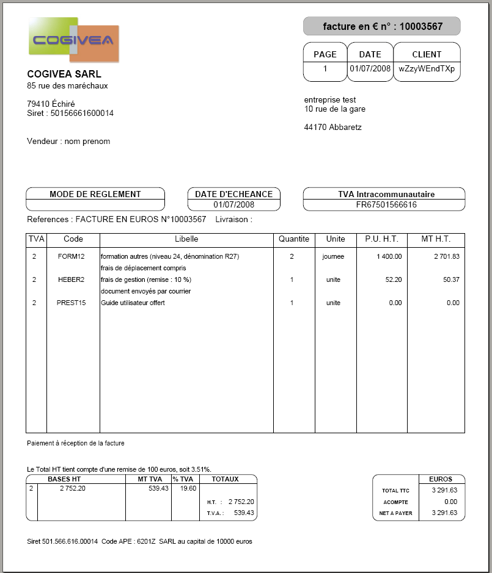
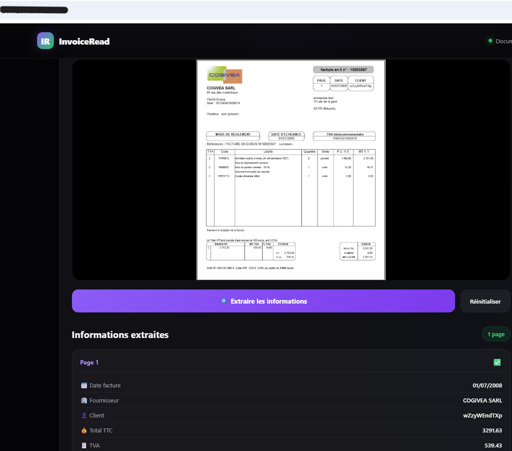

# Invoice Information Extraction App

Deployment of an invoice information extraction application, hosted on a server and accessible on the internet through a domain name.

The frontend is built with HTML, the backend uses FastAPI, and the database is MongoDB.

The application uses QWEN-VL to extract key information from invoices:

- `date_facture`
- `fournisseur`
- `client`
- `total_ttc`
- `tva`

## Application results

