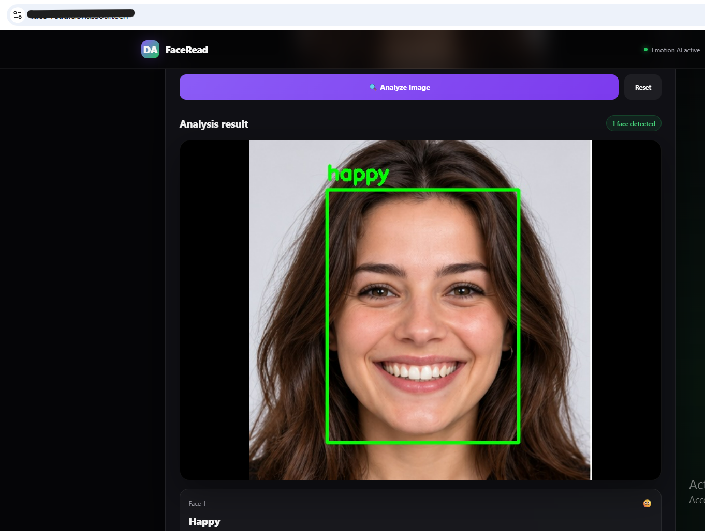
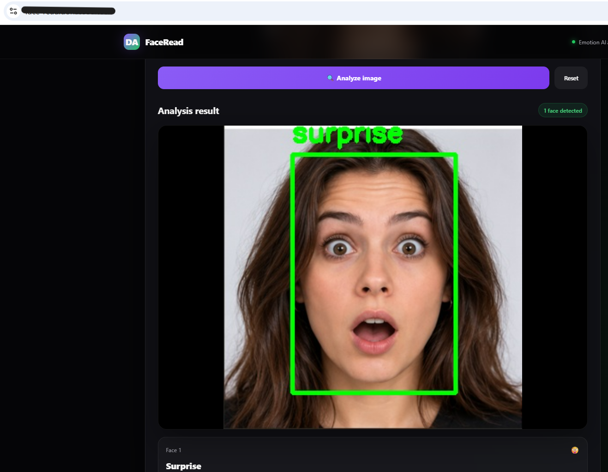

# Face Emotion Classification App

Deployment of a facial emotion classification application, deployed on a server and accessible on the internet through a DNS.

The frontend is built with HTML, the backend uses FastAPI, and the database is MongoDB.

The application's model can classify up to 7 emotions:

angry, disgust, fear, happy, neutral, sad, surprise

## Application results

