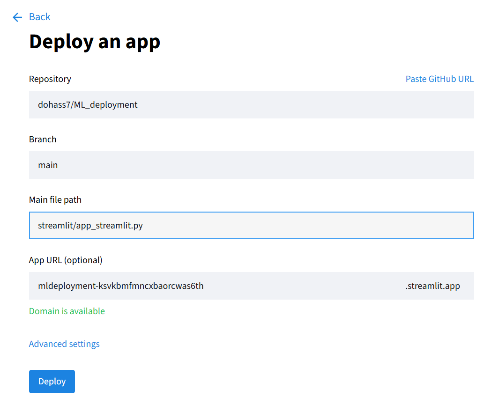
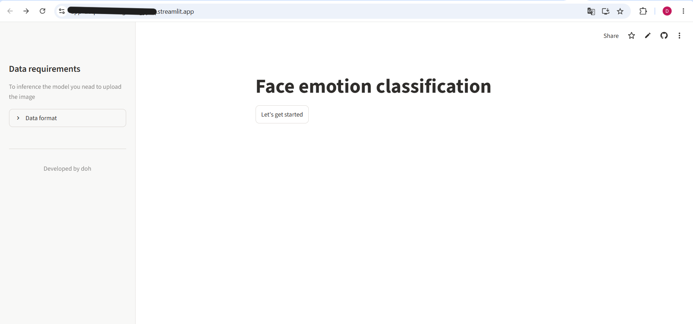

### Local

With Docker Compose: :

```sh
docker compose up -d
```

### Deploy on Streamlit Cloud
With the code hosted on GitHub, go to share.streamlit.io, click on **Create app** then **Deploy a public app from GitHub**, fill in the requested information and launch the deployment.



### Application on Streamlit Cloud

